<p align="center"></p>

<h1 align="center">Electro-Coach</h1>

<p align="center">A pool practice coach for Android, iPhone and computer browsers. It runs timed practice
sessions, logs your drills, keeps your own pre-shot routine one tap away (written your way and
fully editable), brings a tournament-style shot clock to your matches, scores straight pool,
and keeps a practice journal. Add <a href="https://railbird.ai/">Railbird</a> shot exports and
it turns them into progress tracking, a practice plan and heat maps.
No account, no AI needed: your data stays on your device.</p>

<p align="center"><a href="https://github.com/lvandrews/Electro-Coach-App/releases/latest"><b>Download the latest Android app (APK)</b></a> · <a href="#get-the-app">iPhone and computer</a></p>

<table>
<tr><td align="center" valign="top" width="33%">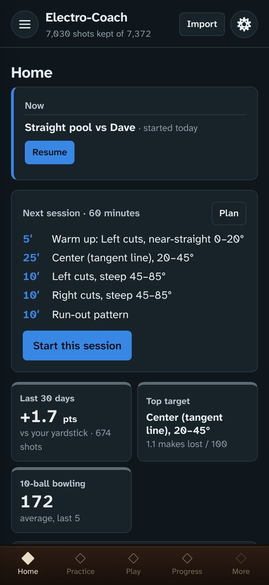<br><sub>Home</sub></td><td align="center" valign="top" width="33%">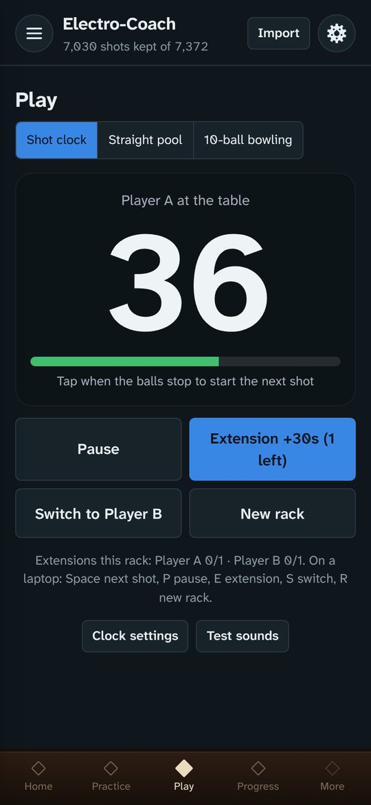<br><sub>Shot clock</sub></td><td align="center" valign="top" width="33%">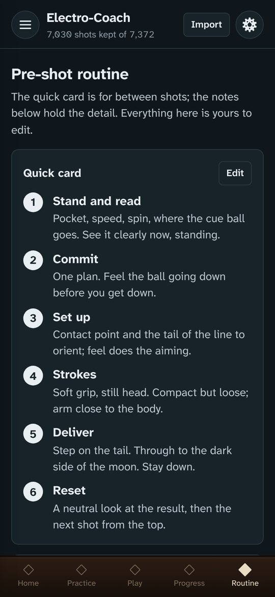<br><sub>Your pre-shot routine</sub></td></tr>
<tr><td align="center" valign="top" width="33%">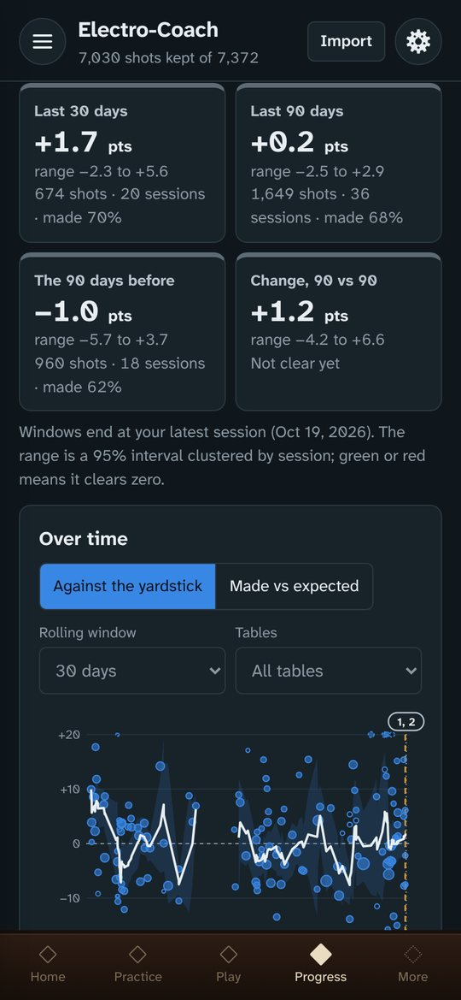<br><sub>Progress</sub></td><td align="center" valign="top" width="33%">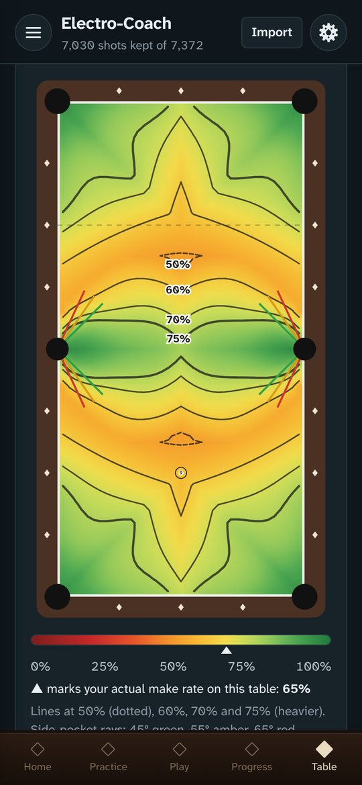<br><sub>Table heat map</sub></td><td align="center" valign="top" width="33%">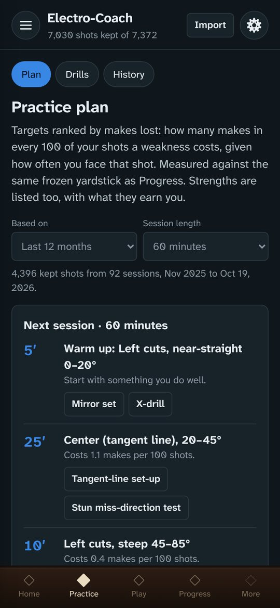<br><sub>Practice plan</sub></td></tr>
</table>

## Get the app

- **Android**: open the [latest release](https://github.com/lvandrews/Electro-Coach-App/releases/latest) on the phone,
  download `electro-coach-<version>.apk` and open it. Android asks once to allow installs from your browser or file app.
  A new version installs over the old one and keeps your data; don't uninstall to update
  (that erases the app's data). The app tells you when a new version is out and offers to
  download it. All versions: [Releases](https://github.com/lvandrews/Electro-Coach-App/releases).
- **iPhone**: open the Electro-Coach web version in **Safari**, tap **Share → Add to Home Screen**,
  and open it from the new icon. It runs full screen and works offline once loaded; your data
  stays on the phone. (The end of a timed practice block sounds only while the app is on
  screen: iPhone web apps can't schedule alerts in the background.)
- **Computer**: open the web version in Chrome, Edge or Safari, or open the single-file
  `Electro-Coach.html` build. Handy for tapping tallies on a laptop while the phone films.

Each device keeps its own data. Move it between devices with **Settings → Back up** and
**Restore**, and back up now and then.

**With or without Railbird.** Drills and tallies, timed practice, straight pool scoring, the
shot clock, FargoRate, the journal and the pre-shot routine all work on
their own. Railbird's shot tracking is what makes the analysis possible: import your Railbird
CSV exports and you get progress against a yardstick, a practice plan ranked by makes lost,
table heat maps, a speed profile and your most reliable shots. The aim is to get more out of
Railbird sessions and to point each one at what to work on next.

**Railbird is a companion, not a chore.** You don't need to film every time you play:

- **Film free play or playing the ghost.** Real games give the widest mix of shots, the ones
  you actually face, so that's where the most useful data comes from.
- **Film a drill now and then to fill gaps.** Most players steer around shots they don't like;
  a short filmed drill makes sure those shots show up in the data too.
- **One or two 20–30 minute recordings a week is plenty.** The rest of practice is tapped on
  the phone (or not recorded at all), and the practice plan keeps filming to the number of
  sessions a week you choose.
- **Electro-Coach does the rest:** it turns what Railbird recorded into a plan aimed at the
  shots that cost you the most makes, builds that into steady practice habits, and shows
  whether it's working.

**Feedback is wanted.** Problems, ideas and drill requests all shape what comes next. To ask
for a drill, find it on [poolbilliards.co](https://www.poolbilliards.co/) and send the link:
in the app, open **Feedback and drill requests** (top of the drawer, or the card on Home and
the Drills page), or [open an issue](https://github.com/lvandrews/Electro-Coach-App/issues/new) here.

**Independent.** Electro-Coach is an independent project. It isn't affiliated with, sponsored
by or endorsed by Railbird, FargoRate or any site or channel listed in its Resources page;
those are listed because they're good resources for the game. Product names belong to their
owners.

## Contents

- [Getting around](#getting-around)
- [Practice](#practice): plan, timed sessions, drills and tallies, history
- [Play](#play): shot clock, straight pool, FargoRate
- [Analysis](#analysis): progress, strengths and the shot model, heat maps, distributions
- [Reference](#reference): pre-shot routine, journal and sharing with a coach or chatbot
- [Data and settings](#data-and-settings): import, cleaning rules, backup, appearance
- [How the numbers work](#how-the-numbers-work)
- [Get the app](#get-the-app) · [Building and hosting](#building-and-hosting) · [Code layout](#code-layout) · [Status](#status)

## Getting around

The bottom bar holds four places one tap away (Home · Practice · Play · Progress by default;
choose your own in Settings → Appearance) and **More**. More, the ☰ button, or a swipe in from the
left edge opens the drawer: every page, grouped, with a search box that also finds drills,
journal entries and sections of the pre-shot routine. Inside Practice, chips switch between
Plan, Session, Drills and History. With large system text the bottom bar scrolls sideways.
The Android back gesture (or back button) returns to the previous screen and closes the
drawer; from Home it leaves the app. On a computer the browser's Back button does the same.

<table>
<tr><td align="center" valign="top" width="33%">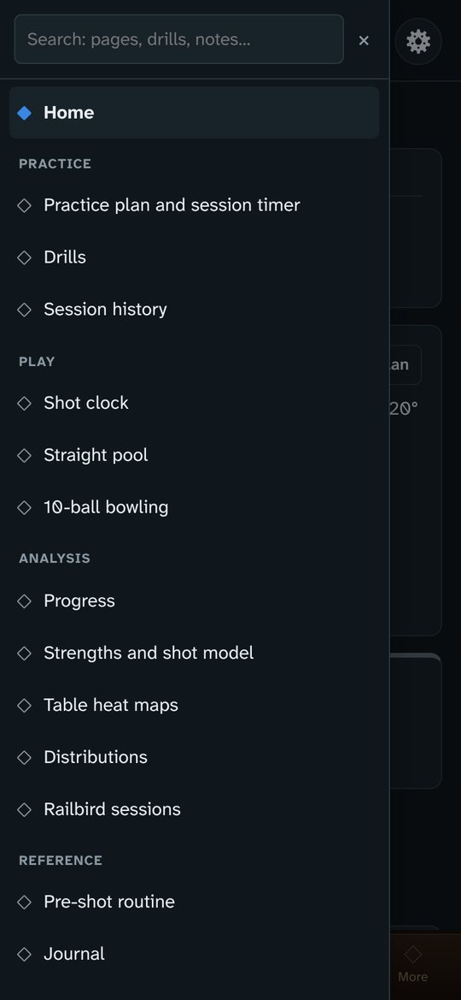<br><sub>The drawer: every page, grouped, with search</sub></td><td align="center" valign="top" width="33%">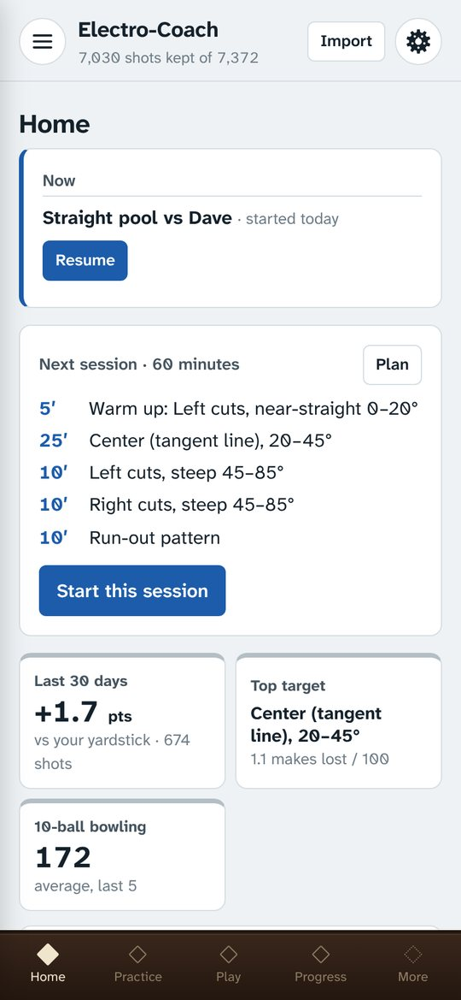<br><sub>Light theme</sub></td></tr>
</table>

| Group | Pages |
|---|---|
| — | **Home**: anything in progress (session, tally, game, match) with Resume or Discard; the next session with Start; the last 30 days against your yardstick, your top target, your best shot, speed sweet spot, FargoRate, bowling-drill and straight-pool numbers; the last few things you did; a quick journal entry; last import and backup |
| Practice | **Practice plan and session timer** · **Drills** (including the 10-ball bowling drill and its scorer) · **Session history** |
| Play | **Shot clock** · **Straight pool** · **FargoRate rating** |
| Analysis | **Progress** · **Strengths and shot model** · **Table heat maps** · **Distributions** · **Railbird sessions** |
| Reference | **Pre-shot routine** · **Journal** · **Resources** |
| Data and settings | **Import Railbird data** · **Settings and backup** |

## Practice

<table>
<tr><td align="center" valign="top" width="33%"><br><sub>Practice plan: targets ranked by makes lost</sub></td><td align="center" valign="top" width="33%">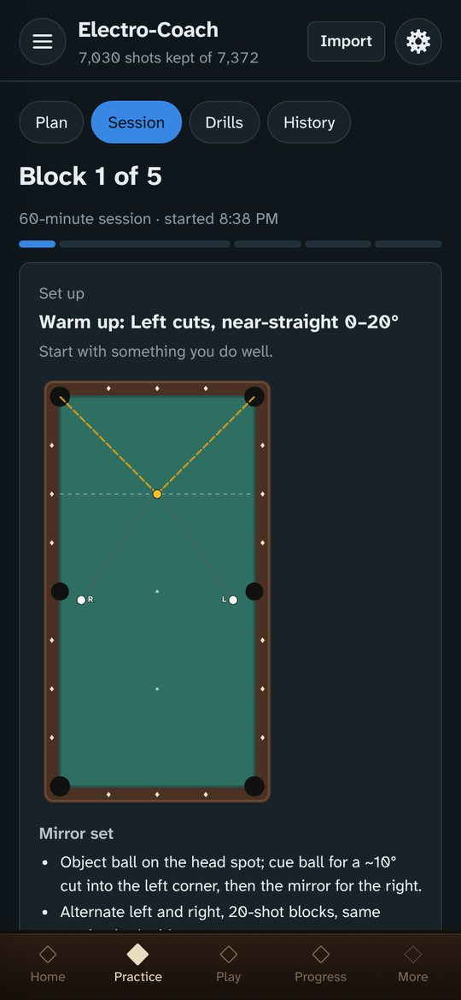<br><sub>Session: each block opens on a set-up card</sub></td><td align="center" valign="top" width="33%">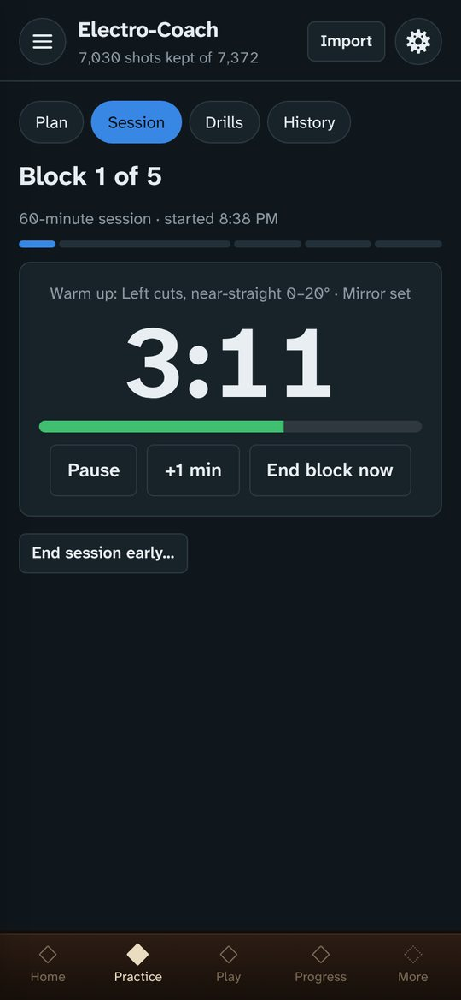<br><sub>Session: the block timer</sub></td></tr>
</table>

**How sessions are built.** Every session opens with stroke drills chosen by your player stage
and drill levels (the X-drill at minimum; Basic stop shots for new players), then the plan's
targets, then a run-out. Block times adapt: they start as estimates and then come from how long
each drill actually took you (the median of your last four), labeled either way and editable.
By default tapped drills **finish each drill**: the planned time is a pace target with a soft
chime, and the block ends when the drill is done (or choose **keep to the time**). Filming is
limited to the sessions a week you choose (2 by default, 20–45 minutes each), in one Railbird
recording with one tag (`ec-filmed`); otherwise practice is tap-only, and drills that need
Railbird swap to a tapped drill or free practice. The session review also offers a
**Tournament warm-up** (five medium-speed basic stop shots) and a **Stroke workout** (all
three levels of each stroke drill). Without any Railbird data the plan still builds sessions
from stroke drills and a run-out.

**Practice plan.** Targets are the kinds of shot where you fall short of your own yardstick,
ranked by how many makes they cost you in every 100 shots (how far below expectation × how often
you face them). Strengths are listed too. Each target links to its drills, can be tracked on
Progress, and holds your own coaching notes. **Next session** turns the top targets into a
timed session (30–120 minutes) with a warm-up on a strength and a closing run-out block.

**Timed sessions.** Review the blocks first (drill, minutes, recording mode, how each block
ends), then run them one at a time on one phone:

- **Film with Railbird** blocks: put the phone on its stand and start Railbird with the tag
  shown. When time is up, an Android notification arrives even though Railbird is in front, and
  a paired watch buzzes (Garmin: turn on smart notifications for Electro-Coach in Garmin Connect).
- **Tap on the phone** blocks open the tally, and can end on time, at a count (racks, shots,
  games) or whichever comes first.
- Nothing moves on by itself: "Time" shows and the next block waits for your tap. Filmed blocks
  are grouped so the phone goes onto its stand once, and changeover minutes come out of the
  blocks so the session length holds. It ends with a log, a 1–5 rating and a note for the Journal.

<table>
<tr><td align="center" valign="top" width="33%">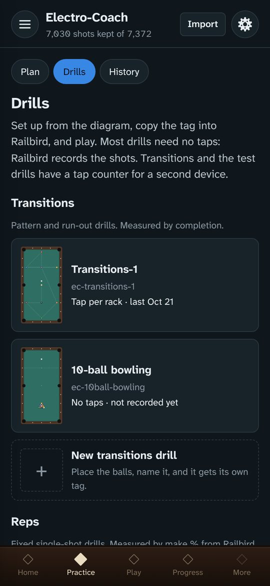<br><sub>Drill library</sub></td><td align="center" valign="top" width="33%">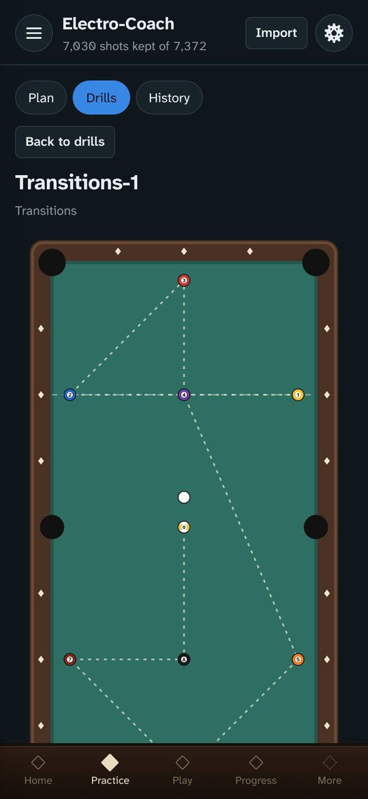<br><sub>Transitions-1: diagram, tag, how racks end</sub></td><td align="center" valign="top" width="33%">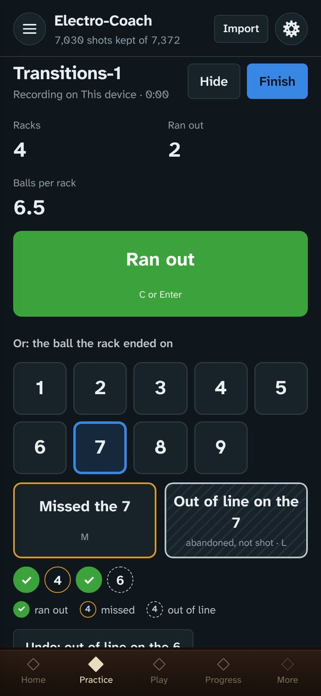<br><sub>Tapping a Transitions rack</sub></td></tr>
</table>

**Stroke drills.** Four straight-in drills, tapped shot by shot with large buttons, each with
three levels set by cue ball distance: **Mid-table stop shots** (15 balls across the table,
stop shots), the **X-drill** (30 makes: 10 follow, 10 stop, 10 draw), **Center table follow**
and **Center table draw** (sets of 10, with a right- or left-handed set-up). Misses are tapped
left or right (or "not sure") and repeated until made; each make records its quality (followed
in, stopped within a ball's radius, drawn back to the rail or into the corner) and any drift.
A set scores make % and quality %. Two sets in a row at 80% made and 70% quality move you up a
level; two in a row under 70% made or 50% quality move you down (one bad day never does). The
thresholds are adjustable, and you can always set the level yourself.

**Basic drills.** **Basic stop shots** (cue ball on the center spot, object ball an inch off a
side pocket's lip; low, medium or high speed; sets of 5 or more) record whether the cue ball
stopped dead, stopped spinning, or drifted, and turn the pattern into feedback: spin means you
missed the center of the cue ball, drift means you missed the center of the target. **Basic
draw shots** (sets of 7) record a draw into the opposite side pocket, or to the rail left or
right of it. **Thin cuts 1 and 2** (cue ball on the center spot; object ball by the side pocket
or by a corner on the short rail) alternate sides after every make, 5 each way, with misses
tapped thick, thin or not sure. **Settings → Player stage** (New, Developing, Advanced,
suggested from your stroke drill levels) tells the practice plan which warm-ups to pick.

**Drills and tallies.** Every drill has a diagram, its Railbird tag with a copy button, set-up
notes and a target. Most drills need no taps; Railbird records the shots. Transitions drills
take one entry per rack (ran out, or the ball where it ended and why: missed, or out of line);
D2 and the mirror set take a tap per shot. An empty tally is dropped when you leave it, and
any tally can be discarded.

**The 10-ball bowling drill** has its own section in the drill library: a run-out drill that
takes full racks, scored like bowling, so set aside time to finish all ten frames. Its scorer
opens from the drill page.

<table>
<tr><td align="center" valign="top" width="33%">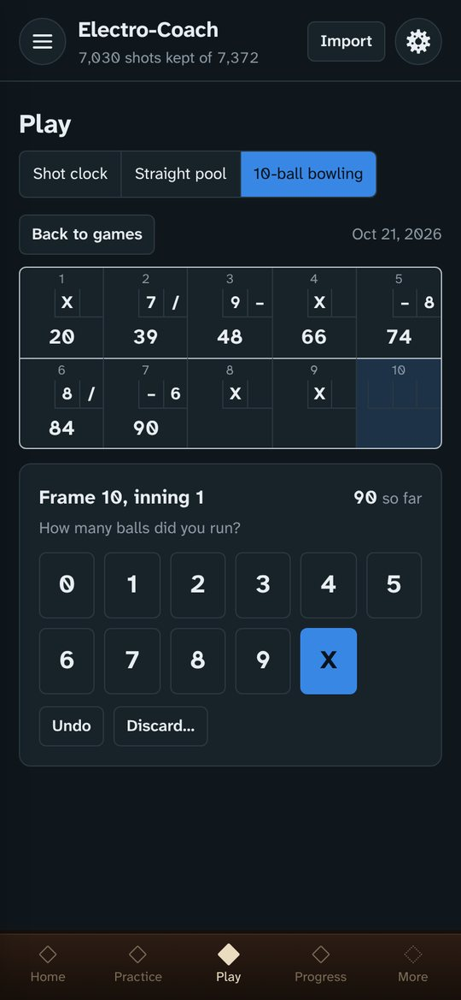<br><sub>10-ball bowling drill scorer</sub></td></tr>
</table>

<details>
<summary><b>More on drills, tallies and the capture check</b></summary>

- **Drills** tab: every drill has a diagram drawn from table coordinates (9-ft, head rail at
  the top), its Railbird tag with a Copy button, set-up notes and a shot target. In the
  diagrams the shot (aim) line is dashed grey and object-ball paths dashed gold; where the cue
  ball travels is a see-through band one ball wide underneath them: white for the cue ball's
  path, red for follow, purple for draw. A **Request a drill** card sits at the end of the list.
- Most drills need no taps. **Transitions** drills take one entry per rack: **Ran out**, or
  the ball the rack ended on plus the reason: **Missed** (shot it and missed) or **Out of
  line** (position lost, abandoned without shooting it). The drill page shows where racks
  end, ball by ball, split by reason. Hard drills (Transitions-1, Double box) start with a
  learning stage: ball in hand on every shot until the patterns are familiar. Racks logged
  with **Learning mode (ball in hand)** switched on are kept but left out of the stats and Progress.
  **D2** and the **mirror set** take a tap per shot: make, thick
  or thin miss, per side; D2 block A also cue ball to rail or pocket. Keyboard keys work on
  a laptop (M make, K thick, N thin, Space switch side, Z undo; Transitions: C or Enter =
  ran out; 1–9 picks the ball, two digits for 10–14, then M = missed or L = out of line).
  Keyboard hints are hidden on touch screens.
- Layouts: tap **Set the layout** to place balls, then **Copy layout** and paste the text into
  `src/drills/layouts.json` (inside `"layouts": { }`). Layouts in that file ship with every
  build. A layout edited on a device overrides the shipped one there until **Restore default layout**.
  **New transitions drill** creates Transitions-2, -3… with their own tags.
- Tally on the laptop (open `Electro-Coach.html` in Chrome or Edge) or a spare Android
  device while the phone runs Railbird. Then **Save tallies as a file** or **Copy tallies as
  text**, and on the phone **Import a tally file** or **Paste tallies**. Re-importing is safe.
- **10-ball bowling drill** (run-out drill, own section in the library): scored like bowling. A frame is a rack of ten with two innings (300
  perfect). Frame-by-frame scorer, score sheet, history chart, strike/spare rates, past games
  entered one at a time or pasted as a list (date + score per line). It is also a drill in the
  library and a Progress drill meter, and the practice plan's run-out block points to it. A
  "How to score" section explains entering balls, X and /.
- **Capture check**: after you import the Railbird export, each tally shows how many of your
  tapped makes Railbird recorded, per side for D2 and the mirror set. Matching is by drill
  (tag, legacy alias or built-in mode) and calendar date.
- Railbird sessions are labeled by drill everywhere (Sessions, Data filters): the old
  "pool kata bassai 9 ball" tag counts as Transitions-1.

</details>

**Session history** is one newest-first timeline of everything: Railbird sessions, tallies,
games, matches and timed practice sessions.

<table>
<tr><td align="center" valign="top" width="33%">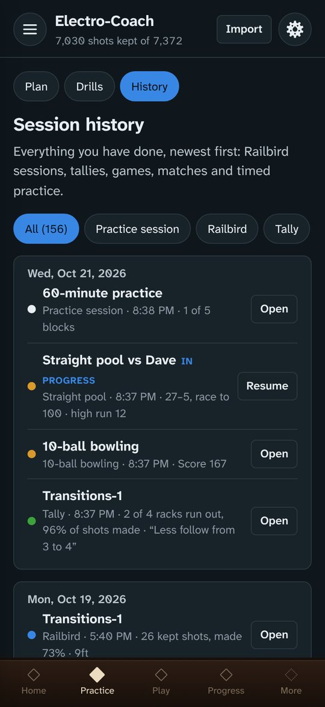<br><sub>Session history</sub></td></tr>
</table>

## Play

<table>
<tr><td align="center" valign="top" width="33%"><br><sub>Shot clock</sub></td><td align="center" valign="top" width="33%">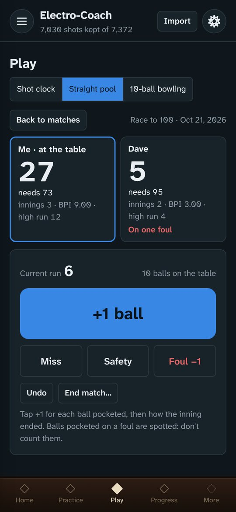<br><sub>Straight pool (14.1)</sub></td></tr>
</table>

- **Shot clock**: built to be read and tapped at arm's length, with large controls and each
  player's side color-coded. Tap the clock when the balls stop to start the shot, and
  **Shot played** when the cue ball is struck.
  - **Rule sets**: Matchroom (World Nineball Tour) by default: 30 s a shot, 60 s for the break
    and the first shot after it, one 30 s extension per player per rack. Also Predator Pro
    Billiard Series, WPBA (40 s a shot, 60 s after the break and after a push out, one 40 s
    extension per player per game, two each once you tap **Hill-hill**) and Custom.
  - **Push out**: on the first shot after the break. The other player gets 60 s to take it or
    **Pass it back**, which gives the player who pushed 30 s.
  - **Two players**: each has their own extension button (tapping yours also makes you the
    shooter), **Turn over** switches who is at the table, and a time foul passes the table
    automatically. **Undo** reverses the last tap; **Pause** sits at the top for interruptions.
  - **New rack** asks who breaks. The clock keeps its place if you leave the page.
  - A **Usage** section explains the buttons and the chosen rules.
  - A chime at 10 s, a beep for each of the last five seconds and a longer two-tone at zero, all
    synthesized with Web Audio (`src/ui/sound.ts`). Volume control; the screen stays on.
    Settings per device. The rules logic is in `src/engine/shotclock.ts`.
- **Straight pool (14.1)**: +1 per ball, then miss / safety / foul (−1); break foul (−2) on the
  opening shot; a third foul in a row costs a further 15. Balls on the table and the re-rack are
  tracked; BPI and high run per player; history chart of your BPI. Pick a past opponent or add a
  new one; each opponent has a page with your record, both players' balls per inning and high
  runs, and the matches. Optional venue. A finished match shares as a one-page **PDF
  scoresheet** or as plain text (email, messages): date, players, race, final score, innings,
  balls per inning, high runs, fouls and every inning with the score after it. Each match (and
  each bowling game) can note the venue and table: brand, model or line, size (9 ft by default;
  each new match or game starts from the table you used last) and pocket size; picking a venue you've played before
  fills in its table. A rules reference covers the break, fouls, three fouls in a row, spotting
  and the re-rack cases (WPA). After a break foul the scorer asks whether the opponent takes the
  table or calls a re-break; after three fouls in a row the offender breaks a full rack again.
- **FargoRate**: your rating over time, with journal entries flagged on the chart. Find
  yourself by name or ID and tap **Update from FargoRate**, or enter ratings by hand. FargoRate
  has no published API; the lookup uses the search endpoint the open-source
  [fargo CLI](https://github.com/rgstephens/fargo-skill) uses, so it may break if FargoRate
  changes it. Manual entry always works.
- Stored in the `games` object store (IndexedDB v3) and in backups.

## Analysis

<table>
<tr><td align="center" valign="top" width="33%"><br><sub>Progress against a frozen yardstick</sub></td><td align="center" valign="top" width="33%">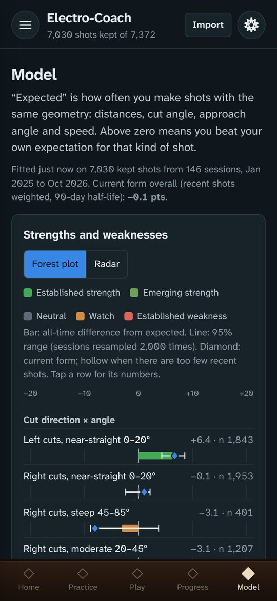<br><sub>Strengths and weaknesses (forest plot)</sub></td><td align="center" valign="top" width="33%">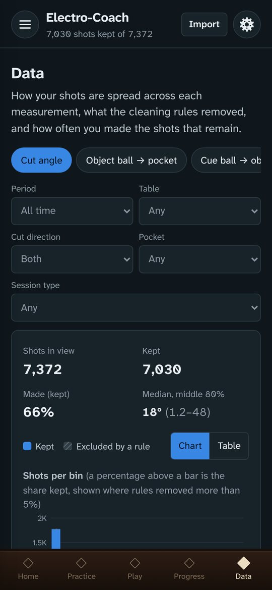<br><sub>Distributions</sub></td></tr>
</table>

- **Progress**: each session against a *frozen* yardstick (your shot model fitted once and
  kept), so improvement shows instead of being absorbed. Windows for the last 30 and 90 days
  and the change between them, a rolling chart with journal entries flagged, tracked segments,
  and drill meters (make rate, Transitions completions and tapped make rate, bowling scores).
- **Strengths and shot model**: how often you make shots against how often you *should*, given
  distance, cut, approach angle and speed, by kind of shot (forest plot or radar), plus a shot
  predictor. **Speed profile**: the speed that makes the most balls at short, medium and long
  distance, from the shot model fitted per distance band with the geometry held fixed, shown
  against the easy (4–7 mph), firm (8–11 mph) and hard (12+ mph, shaded yellow) reference bands. Only speeds you actually play
  are shown; a band with under 10% (or 100) of the shots at a reference speed says there isn't
  enough to judge. Readings below 1.5 mph (Railbird glitches) are left out. **Shots you own**:
  the kinds of shot (cut, distance, speed, spin) you make most reliably, ranked by the low end
  of their 95% range; the top one is Home's **Your best shot** tile.
- **Table heat maps**: your chance from every spot on a 9-ft or 7-ft table into its best pocket;
  tap a spot for every pocket and your real record from similar positions; compare two periods.
- **Distributions** and **Railbird sessions**: the raw data, what the cleaning rules removed,
  session by session.

## Reference

<table>
<tr><td align="center" valign="top" width="33%"><br><sub>Pre-shot routine</sub></td><td align="center" valign="top" width="33%">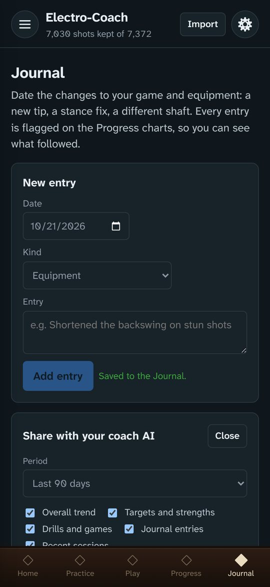<br><sub>Journal and sharing with a coach or chatbot</sub></td></tr>
</table>

- **Pre-shot routine**: a six-step quick card for between shots and detailed notes (stroke and
  delivery, speed, quick checks, shot selection, after a miss, table conditions). Every line is
  editable. Under the rules of thumb, **Your numbers** show your own data live: speed sweet
  spots, make chance by distance and cut angle, side-pocket make rates by approach angle, and
  7-ft vs 9-ft tables against the model.
- **Home-screen widget (Android)**: add **Pre-shot routine** from your home screen's widget list.
  It shows the quick card, then scrolls to the full notes, updates whenever you edit them, and
  opens the routine page when tapped. Its text follows the phone's text size, with Large and
  Extra large options on the routine page.
- **Resources**: grouped links (training tools, instructional channels, rating, matches) that
  open in your browser. Add, edit, reorder or remove them; they're searchable from the drawer
  and included in backups.
- **Journal**: dated entries for changes to technique or equipment, coach or chatbot summaries
  and tally notes, flagged on the Progress charts. **Share with your coach AI** builds one plain
  text summary any chatbot can read: how to read the numbers, your trend, targets and
  strengths, drills and games, journal entries with the 30 days before and after each, and
  recent sessions (plus an optional CSV of shots). Paste a chatbot's reply back in as a
  "Coach or chatbot summary" entry.

## Data and settings

<table>
<tr><td align="center" valign="top" width="33%">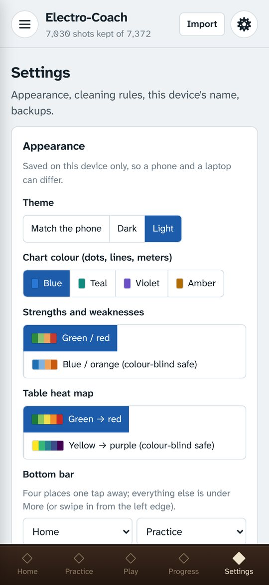<br><sub>Settings: appearance and the bottom bar</sub></td></tr>
</table>

- **Import**: Railbird CSV exports, all-time or partial, as often as you like. Shots are merged
  by ID (re-importing is safe; corrected shots update) and every import gets a report.
  On Android you can also share an export straight to the app (Share → Electro-Coach, or
  Open with → Electro-Coach from a file manager) and it imports at once.
- **Cleaning rules** decide which stored shots count; they are reversible and never delete data.
- **Backup and restore**: one file with everything (shots, tallies, games, journal, plan,
  routine, settings). Home reminds you when the last backup is old.
- **Reminders** (Android, per device): a nudge after 3 days without logging any practice and
  one more after 7, then nothing until you log again; and a recap the morning after a practice
  day of what you did. Both can be switched off, and their times chosen.
- **Appearance** (per device): theme (match the phone, dark, light), chart color,
  strength/weakness colors (including a color-blind-safe set), heat-map scale (green→red or
  color-blind-safe viridis) and the four bottom-bar slots.
- **Anonymous usage counts** (on by default, with a note on first launch; switch off in
  Settings). To see which parts of the app get used, it counts screens opened (once each per
  launch) and features used: an import, a timed session, a drill tally, a game, the shot clock,
  a routine edit and the like, with the app version, the kind of device and the language setting.
  The counts go to [Aptabase](https://aptabase.com/), a privacy-first analytics service, which
  works out the country from the connection and doesn't store the address. Nothing you enter is
  ever sent: no shots, scores, notes, routine text, names, venues or FargoRate ID, and there is no
  account, device ID or install ID. The full list is in `src/engine/usage.ts`.
- **Updates** (Android): when the app opens (at most twice a day) it asks GitHub for the latest
  release. If there's a newer one it shows what's new and offers **Download**, **Not now** (asks
  again tomorrow) or **Skip this version**. It never downloads anything without asking.
- **About**: the version you have, a Check for updates button, how Railbird fits, a privacy
  summary and the copyright.
- **Feedback and drill requests** (top of the drawer; also on Home, the Drills page and About):
  **Request a drill** takes a link from poolbilliards.co (or any link or description),
  **Report a problem** and **Suggest an idea**. Each opens a GitHub issue with the app version
  filled in; you need a free GitHub account, and issues are public.

**Feedback**: [open an issue](https://github.com/lvandrews/Electro-Coach-App/issues/new) for a problem, an idea or a drill request (a poolbilliards.co link is perfect), or use **Feedback and drill requests** in the app.

## How the numbers work

<details>
<summary><b>Data flow and cleaning rules</b></summary>

```
Railbird CSV ─► parse (header aliases, numeric coercion, unit conversion)
             ─► merge by shot_id (idempotent; newer export wins on corrected shots)
             ─► rules over the WHOLE record (excluded shots are kept, never deleted)
             ─► screens
```

The cleaning rules reproduce workbook v15 exactly; `npm test` checks this against
the all-time export (7,297 raw → 6,957 kept; cut > 85° 303, approach > 90° 7,
break ≥ 18 mph 43, duplicates 17, false positive 0).

| Rule | Default |
|---|---|
| Incomplete record | missing make, cut angle or either distance |
| Implausible cut angle | > 85° |
| Impossible approach angle | > 90° |
| Railbird false-positive flag | score ≥ 0.5 |
| Break shot | ≥ 18 mph (speed = inches/second ÷ 17.6) |
| Duplicate record | same session, start frame ±10, cut ±5°, pocket distance ±3″ of an earlier shot |
| Distance beyond table (optional, off) | either distance > table diagonal |

</details>

<details>
<summary><b>Shot model and strengths</b></summary>

- **Expected make** comes from a logistic regression fitted on the device to every kept shot:
  object→pocket and cue→object distance (ft), sec(cut) − 1, approach angle (per 10°), speed
  and speed². Standard errors are clustered by session. The fit matches statsmodels to six
  decimals (see `test/model.test.ts`).
- **Strengths ledger**: O−E (made minus expected) per segment, 95% range from a 2,000-rep
  session bootstrap, tiers as in the workbook (established when the range clears zero;
  emerging / watch at ±2 points; neutral otherwise), and current form with a 90-day half-life
  (hollow when the effective sample is under 80). Spin types are compared within cut bands,
  because Railbird's spin label depends on cut angle. Equipment rows are condition effects.
- **Forest plot ⇄ radar** toggle; the radar uses the workbook's ten collapsed axes.
- **Shot predictor**: make chance with a 95% range, your own record for similar shots, and
  the speed curve with the best speed and the band within 2 points of it.

</details>

<details>
<summary><b>Table heat maps</b></summary>

- Each spot shows the chance of potting a ball from there into its best pocket. Distance to
  the pocket and approach angle come from the spot (Railbird's definition: corners measured
  from the 45° bisector, sides square to the rail); cut, cue-ball distance and speed are
  averaged over your kept shots, or the cut is fixed at 10°/30°/45°/60°.
- The position model reuses the step 2 terms with a natural cubic spline for distance
  (knots at 0.3, 0.9, 1.75, 2.75 and 4.5 ft), a squared corner-approach term and side-pocket
  terms. Every term is smooth, so contours only bend sharply where the best pocket changes.
  On 9-ft tables it matches the actual make rate within about 2 points on average across
  distance bands (`test/heatmap.test.ts`). Within about a foot of a corner at shallow
  approach the map reads about 7 points high, because shots actually taken from there are
  thinner cuts with the cue ball farther away than the average shot the map assumes.
- The 7-ft map gets its own offset so its average matches what you make on 7-ft tables.
- Colors run on an absolute scale from red (rarely made) through orange and yellow to green
  (near-certain), with your actual make rate on that table marked on the legend;
  contours at 50/60/70/75%; side-pocket rays at 45°/55°/65°. Tap a spot for the best pocket,
  the others, and your record from similar positions. Two periods can be compared side by side
  on one color scale.

</details>

<details>
<summary><b>Progress and the frozen yardstick</b></summary>

- **Frozen yardstick.** The step 2 model is fitted once on the sessions up to a cutoff date and
  its coefficients are stored (settings key `baseline`). New imports never refit it, so
  improvement shows as a rising O−E instead of being absorbed. The first visit freezes it on
  everything so far; *Change* moves the cutoff (an earlier date measures what follows out of
  sample).
- **Windows**: last 30 days, last 90, the 90 before, and the change between them, ending at the
  latest session. O−E is pooled over shots; its 95% range uses a session-clustered standard
  error, var = G/(G−1) · Σ(R_s − n_s·O−E)² / N².
- **Over time**: per-session O−E dots and a rolling 30/60/90-day line with its band, or made vs
  expected; a table-size filter; the freeze date and numbered note flags on the chart.
- **Segment meters**: the ledger's segments (equipment rows and radar axes left out). With
  nothing chosen, those whose all-time range clears zero are suggested, ranked by makes lost or
  gained. Pins are stored (settings key `pins`).
- **Drill meters**: rep drills from Railbird sessions, Transitions from tapped completions
  (with how racks ended), diagnostic drills from taps; the last five sessions against everything
  before (the later half against the earlier with fewer than ten sessions).
- **Notes**: dated notes (technique / equipment / other) plus post-session tally notes, flagged
  on every chart. Stored in settings key `notes`; baseline, notes and pins are in backups.

</details>

<details>
<summary><b>Practice plan</b></summary>

- **Targets** are the ledger's segments that sit below the frozen yardstick (tier *Established
  weakness* or *Watch*, from a session-clustered 95% range), ranked by **makes lost per 100 of
  all your shots** = (expected − made) ÷ all shots in the period: volume × deficit. Strengths
  are ranked the same way by makes gained. Period: all time, 12 months (default), 6 months or
  90 days.
- Segments overlap; each item notes the largest share of its shots that fall inside a
  higher-ranked one.
- **Next session**: a warm-up on the top strength (≈12%), up to three targets sharing the time
  by makes lost (10 minutes each at least; a target with 35%+ of its shots inside one already
  chosen is skipped, and session-type rows are left to the closing block), and a run-out block
  (≈20%).
- Each item links to its drills, to a Progress meter (*Track on Progress*), and holds your own
  coaching text. Settings key `plan` (in backups).

</details>

<details>
<summary><b>Timed practice sessions</b></summary>

- Built from the plan's next session (`src/engine/session.ts`). Each block has a drill, minutes,
  a recording mode (tap on the phone / film with Railbird / none) and an end rule (time, a count
  of racks, shots or games, or whichever comes first). Filmed blocks are grouped together; a
  minute of changeover between drills, two when the phone goes onto or off its stand, comes out
  of the block time so the session length holds.
- Each block opens on a set-up card (diagram, Railbird tag to copy, what to do) and starts when
  you tap. When it is due, the app plays a tone and shows "Time"; the next block waits for you.
- Filmed blocks schedule an Android notification for their end (`@capacitor/local-notifications`,
  `src/notify.ts`), which arrives while Railbird is in front and is mirrored by a paired watch
  (Garmin: turn on smart notifications for Electro-Coach in Garmin Connect). For alerts to the
  second, allow "Alarms & reminders" for the app when asked.
- The session ends with a log (planned vs actual minutes, counts), a 1–5 rating and a note that
  can go to the Journal. Sessions are stored with the games.

</details>

## Building and hosting

### The Android APK

Every push to `main` runs *Build Android APK* (Actions tab): tests, the web build, then the
APK. Each build is published as its own release (`v0.1.N`, marked latest) with the APK named
by version, `electro-coach-0.1.N.apk`; the download link at the top always opens the newest.
Version numbers continue from the earlier private repository (`VERSION_OFFSET` in the
workflow), because Android won't install a lower version over a higher one.

Every build is signed with the same key and has a higher version number, so a new APK
installs over the old one. The key comes from the `ANDROID_KEYSTORE_BASE64` repository
secret; the key file is never committed (`android/keystore/` is git-ignored). Anyone holding it could sign
an APK that installs over yours.

### The web version (iPhone and computers)

Hosted on [Netlify](https://www.netlify.com/) (free): *Add new site → Import an existing
project → GitHub →* this repository. `netlify.toml` sets the build, so there's nothing to
fill in, and Netlify rebuilds on every push. FargoRate lookups go through the site
(`/fargo-api/`, also in `netlify.toml`) because FargoRate doesn't accept requests from other
websites.

### Running on a computer

```
npm install
npm run dev        # opens at http://localhost:5173
npm test           # engine tests
```

Data in the browser version is separate from the phone's. Move it with Backup / Restore.

The single-file build, `Electro-Coach.html`, opens straight from disk in Chrome or Edge.

### Building the APK locally (optional)

Needs Android Studio (JDK 21, Android SDK 36).

```
npm run android:sync
cd android && ./gradlew assembleDebug
```

## Code layout

- `src/engine/`: pure TypeScript, no DOM; the part to port if the app moves to Kotlin.
  Parsing, rules and merging (`parse.ts`, `rules.ts`, `merge.ts`), drills and table geometry
  (`drills.ts`, `table.ts`), tallies (`tally.ts`), the shot model and strengths ledger
  (`model.ts`, `ledger.ts`), heat maps (`heatmap.ts`), progress (`progress.ts`), the practice
  plan (`plan.ts`), timed sessions (`session.ts`), games (`games.ts`), the coach summary
  (`coach.ts`), the pre-shot routine text and its live numbers (`routine.ts`, `facts.ts`), the
  speed profile (`speed.ts`), straight pool scoresheets and opponents (`scoresheet.ts`, with a
  small PDF writer in `pdf.ts`), FargoRate (`fargo.ts`), resource links (`resources.ts`), the anonymous usage events (`usage.ts`;
  sending is in `src/usage.ts`) and the update check (`update.ts`; fetching is in `src/update.ts`).
- `src/store/db.ts`: IndexedDB storage, backup and restore.
- `src/ui/`: Preact screens; charts are hand-written SVG. `nav.ts` lists every page and the
  bottom-bar choices; `notify.ts` schedules end-of-block notifications.
- `test/`: engine tests (`npm test`). Put your exports in `test/fixtures/` as `all-time.csv`,
  `2026-10-18.csv` and `2026-10-20.csv` (git-ignored; tests that need them skip when absent).
  With all three, the tests check workbook v17: 7,372 stored → 7,030 kept.
- `docs/`: the icon and these screenshots.

## Status

The five planned build steps are done (import and cleaning, the shot model, heat maps,
progress, the practice plan), along with drills and tallies, Play, Home, the drawer, the
journal, the pre-shot routine and timed sessions; then the learning stage, the speed profile,
your numbers in the routine, straight pool opponents and scoresheets, FargoRate, Resources,
the iPhone web version, Android share-to-import, practice reminders, anonymous usage counts,
the update check and the About page.

Next ideas: a native iPhone build (TestFlight), a Double L variant, an importer for past 10-ball bowling drill scores, Railbird
sessions matched to timed-session blocks, and optional cloud sync between devices.

## License

Copyright © 2026 Lela Andrews. All rights reserved. See [LICENSE](LICENSE).
